# Chaos & Coffee

*Merge și așa.* ("It works like this too.")

A one-person organisation for [Victor](https://github.com/vfdavidescu)'s side projects:
homelab tinkering, small apps, and whatever else needs a home on a Steam Deck.
Most of it is private while it settles; things will appear here as they are ready.

## How things work here

- Everything about this organisation is managed as code, with Terraform.
- Every change goes through a pull request; nothing is pushed straight to `main`.
- Commits follow [Conventional Commits](https://www.conventionalcommits.org/), and releases follow [SemVer](https://semver.org/).

